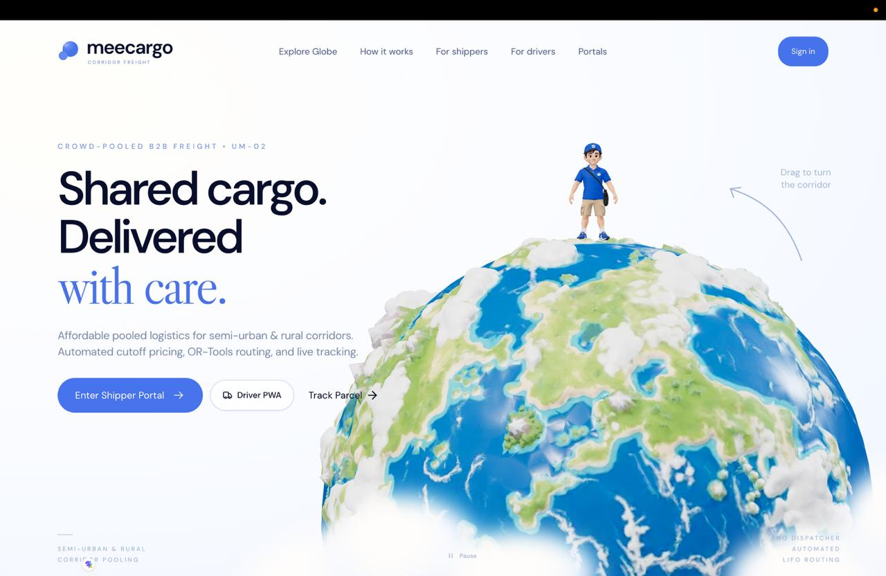
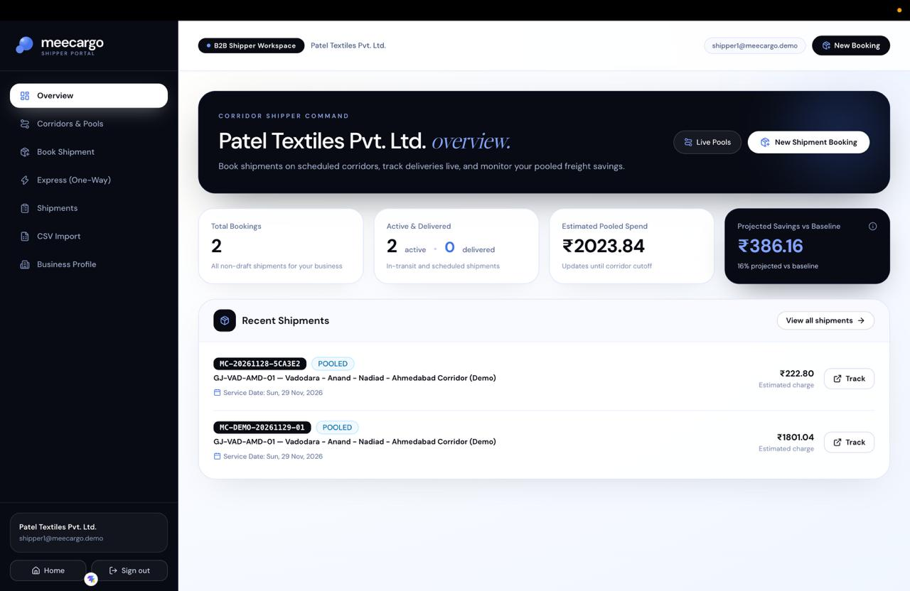
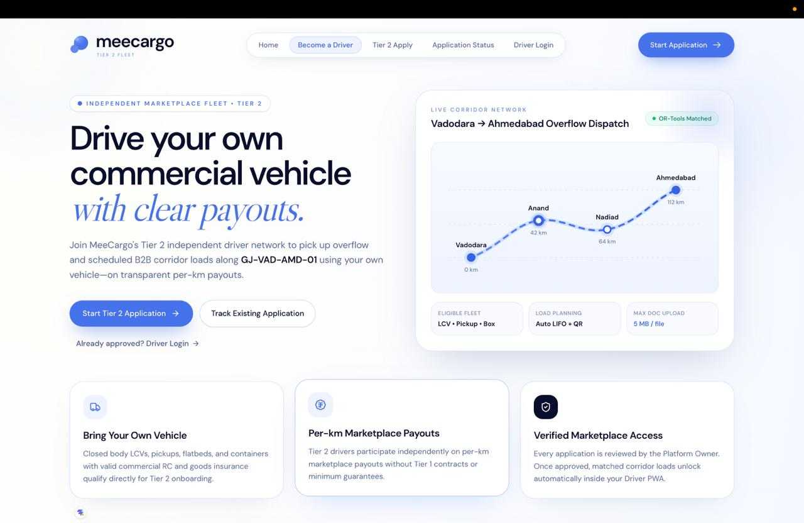
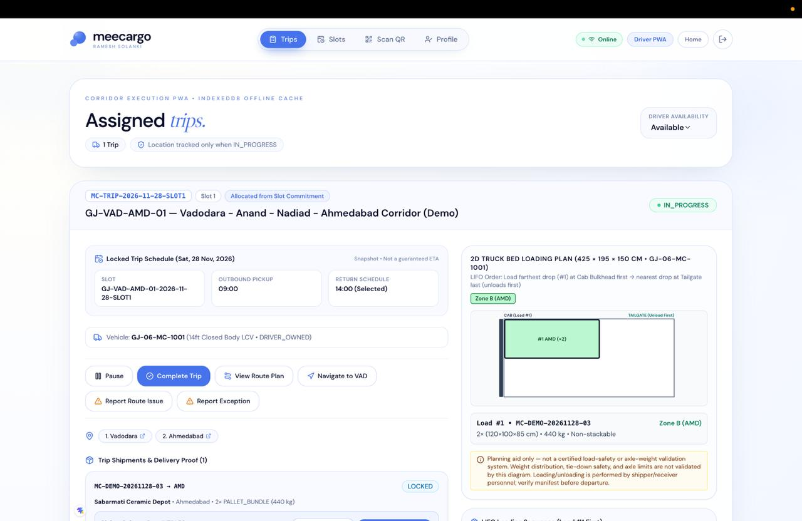

# MeeCargo

**Asset-Light, Shared Freight Logistics Platform for Small Companies**


---

## Problem Statement

### Affordable Logistics Solutions for Small-Scale Companies in Semi-Urban and Rural Areas

Small-scale companies operating in semi-urban and rural areas face significant challenges in transporting goods due to limited access to reliable and affordable logistics services. High transportation costs, limited availability of logistics providers, inefficient route planning, and difficulties in coordinating shipments increase operational expenses and affect delivery timelines. These challenges restrict business growth, reduce market accessibility, and make it difficult for small-scale companies to distribute their products efficiently across different locations.

---

## Platform Showcase

### Landing Page


### Shipper Dashboard & Corridor Booking


### Driver Onboarding & Verification


### Driver Operations & Marketplace Dashboard


---

## Business Model

### Revenue Model (3 Core Revenue Streams)

1. **Shared Outbound Freight (Rural → City)**
   - **Dynamic Group Pricing:** Shippers book with a transparent guaranteed ceiling of **₹2.80/kg**, which drops dynamically toward **₹2.00/kg** as truck pool utilization rises.
   - **Anchor Shipper Incentive:** The first shipper initiating a corridor pool receives an extra **5% discount (down to ₹1.90/kg)** to seed early liquidity.
   - **Two-Stage Collection:** Shippers pay a **15–20% refundable booking token** upfront to lock capacity, with the remaining discounted balance collected via **UPI at pickup QR scan**.

2. **Return-Trip Backhaul (City → Rural)**
   - **Empty-Leg Monetization:** Fills returning corridor trucks with urban wholesale goods at **₹1.60/kg** (20–30% savings compared to standard one-way rates).
   - **Driver & Platform Margin Expansion:** Adds **₹1,200–₹1,440** in incremental revenue per round trip on virtually the exact same fuel outlay.

3. **Overflow & Express Commission (15%)**
   - **Elastic Tier 2 Marketplace:** Captures a **15% platform commission** on extra on-demand marketplace vehicles, urgent direct one-way Express orders, and dynamically batched New-Route trips when contracted capacity overflows or direct dispatch is requested.

### Target Users & Go-To-Market (GTM)

- **Target Shippers:** Rural manufacturers, agro-traders, kirana wholesalers, hardware/textile suppliers, and urban wholesale distributors shipping return loads back to district markets.
- **Go-To-Market Rollout:**
  1. **Start Small in One District (Pilot Launch):** Concentrate density on one proven rural-to-city corridor (e.g., Vadodara → Anand → Nadiad → Ahmedabad `GJ-VAD-AMD-01`) with predictable daily morning/afternoon slots.
  2. **Safe Launch Offers for Early Traders:** Protect MSMEs with guaranteed maximum ceiling rates, refundable tokens on low-utilization slots, and automated rollover options.
  3. **Steady Drivers & Low-Cost Route Expansion:** Anchor reliable base frequency with contracted Tier 1 drivers while testing new corridors and urgent demand via Tier 2 independent drivers before locking long-term fixed commitments.

---

## Tech Stack

| Layer | Technologies |
| --- | --- |
| **Frontend (`frontend/`)** | React 19, Vite 8, TypeScript, Tailwind CSS v4, React Router v7, TanStack Query v5, Zustand v5, React Hook Form + Zod, Leaflet, Recharts, Three.js (`@react-three/fiber`), `html5-qrcode`, `qrcode`, Dexie (IndexedDB offline sync), `vite-plugin-pwa`, Socket.IO Client |
| **Backend (`backend/`)** | Node.js `>= 20`, Express 5, TypeScript, Mongoose 9, Socket.IO, Zod, JSON Web Tokens (`jsonwebtoken`), `bcryptjs`, Multer, Helmet, `express-rate-limit`, Vitest + Supertest |
| **Route Optimizer (`optimizer/`)** | Python `>= 3.11`, FastAPI, Pydantic v2, Google OR-Tools (`ortools`), Uvicorn, Pytest |
| **Database & Real-Time** | MongoDB Atlas (replica set enabled for multi-document ACID transactions & concurrency-safe atomic locks) + Socket.IO live corridor/driver updates |

---

## Environment Configuration (`.env.example`)

Copy each `.env.example` template before running the services. **Never commit `.env` files or secrets.**

### Backend (`backend/.env.example`)

```dotenv
PORT=5000
NODE_ENV=development
ORIGIN=http://localhost:5173
MONGODB_URL=mongodb+srv://<username>:<password>@<cluster>.mongodb.net/meecargo?retryWrites=true&w=majority
JWT_SECRET=meecargo-dev-jwt-secret-change-me
JWT_REFRESH_SECRET=meecargo-dev-refresh-secret-change-me

# Logistics & Pricing Configuration
VOLUMETRIC_DIVISOR=5000
TOKEN_PERCENTAGE=15
PAYMENT_MODE=TEST_GATEWAY
ROUTING_PROVIDER=FIXTURE
OSRM_BASE_URL=https://router.project-osrm.org
OPTIMIZER_URL=http://localhost:8000
OPTIMIZER_TIMEOUT_MS=5000
GEOCODING_PROVIDER=FIXTURE
NOTIFICATION_PROVIDER=CONSOLE

# Singleton Platform Owner Provisioning
PLATFORM_OWNER_EMAIL=owner@meecargo.demo
PLATFORM_OWNER_PASSWORD=Demo@1234
PLATFORM_OWNER_NAME=MeeCargo Platform Owner

# Optional: set positive numeric kg CO2/ton-km to enable CO2 impact estimates
CO2_EMISSIONS_FACTOR_KG_PER_TON_KM=
```

### Frontend (`frontend/.env.example`)

```dotenv
# Leave empty in dev to use Vite proxy (/api -> http://localhost:5000), or set explicit backend origin
VITE_API_URL=http://localhost:5000
```

---

## Project Initialization

### Prerequisites

- **Node.js** `>= 20` and **npm** `>= 10`
- **Python** `>= 3.11` with `venv` / `pip`
- **MongoDB** replica-set URI (MongoDB Atlas or local replica set configured as `MONGODB_URL` in `backend/.env`)

### 1. Configure Environment & Install Dependencies

```bash
# Backend setup
cd backend
cp .env.example .env
# Update MONGODB_URL and JWT secrets in backend/.env
npm install

# Frontend setup
cd ../frontend
cp .env.example .env
npm install

# Python OR-Tools Optimizer setup
cd ../optimizer
python -m venv .venv
```

Activate the Python virtual environment and install dependencies:

```powershell
# Windows PowerShell
.\.venv\Scripts\Activate.ps1
pip install -r requirements.txt
```

```bash
# Linux / macOS
source .venv/bin/activate
pip install -r requirements.txt
```

### 2. Seed Corridor, Fleet & Demo Accounts

From `backend/`:

```bash
cd backend
npm run seed          # Upserts corridors, slots, vehicles, and demo accounts
npm run seed:reset    # Resets mutable state and replays a clean operational baseline
```

Seeded accounts (default password: `Demo@1234`):
- **Platform Owner:** `owner@meecargo.demo`
- **Shippers:** `shipper1@meecargo.demo`, `shipper2@meecargo.demo`, `shipper3@meecargo.demo`
- **Tier 1 Contract Driver (`GJ-06-MC-1001`):** `driver1@meecargo.demo`
- **Tier 2 Marketplace Driver (`GJ-06-MK-2044`):** `driver2@meecargo.demo`

### 3. Start All Services

Run each service in a separate terminal:

```bash
# Terminal 1: Python Route Optimizer (port 8000)
cd optimizer
uvicorn app.main:app --host 0.0.0.0 --port 8000

# Terminal 2: Node.js + Express Backend API (port 5000)
cd backend
npm run dev

# Terminal 3: React + Vite Frontend PWA (port 5173)
cd frontend
npm run dev
```

Access points:
- **Web App:** `http://localhost:5173`
- **Backend Health Check:** `http://localhost:5000/api/v1/health`
- **Optimizer Health Check:** `http://localhost:8000/health`

---

## Verification Commands

```bash
# Route optimizer tests
cd optimizer && pytest -v

# Backend TypeScript check, Vitest suite, and build
cd backend && npm run typecheck && npm test && npm run build

# Frontend TypeScript check, production PWA build, and ESLint
cd frontend && npm run build && npm run lint
```
